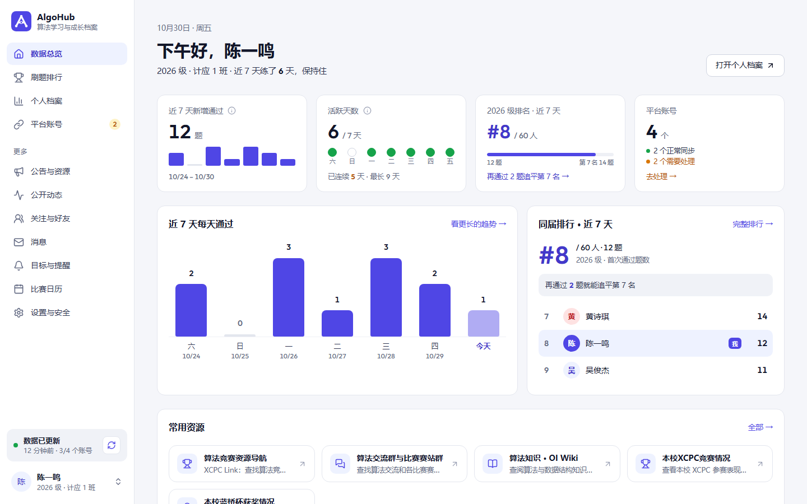
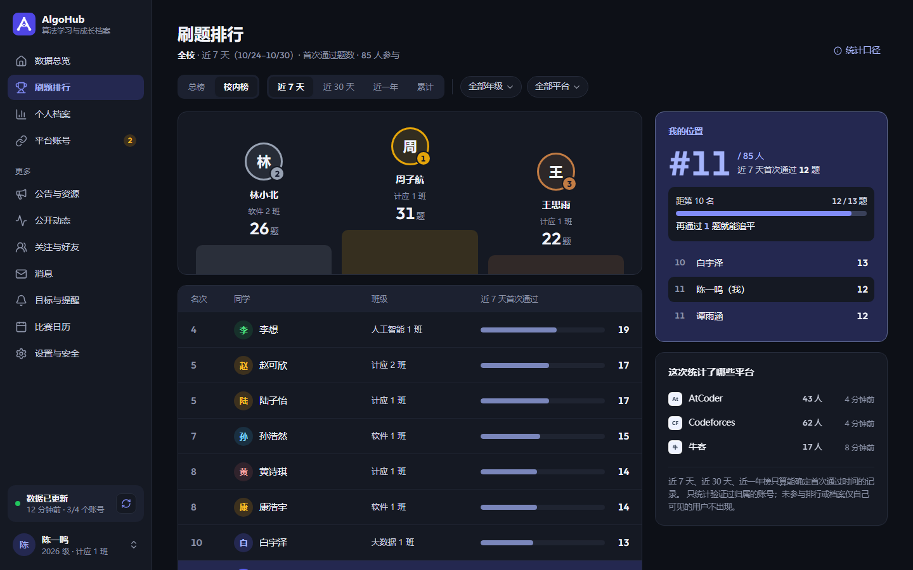
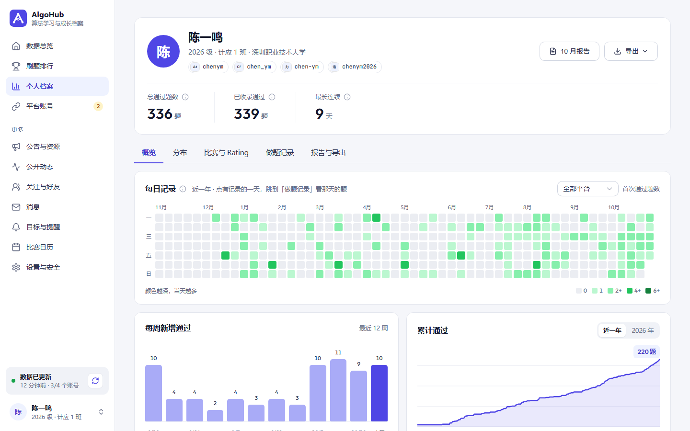
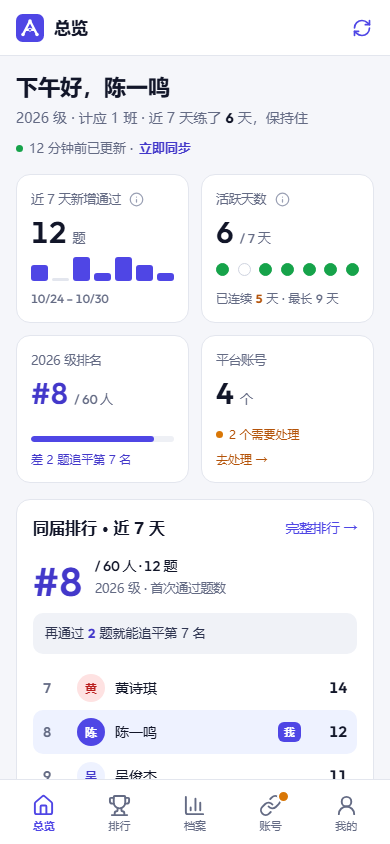
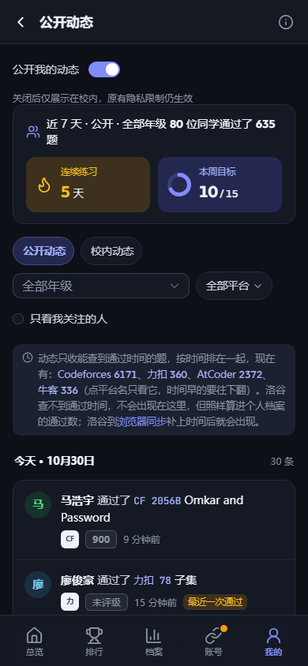

# AlgoHub

[](https://github.com/longtiandragon/algohub-community/actions/workflows/ci.yml)
[](LICENSE)

AlgoHub 是多 OJ 记录聚合、统计和公开动态平台，**不是在线评测系统**，不接收代码进行评测。

它汇总第三方平台的账号、通过记录和比赛信息，提供个人档案、热力图、排行、动态、学习提醒及学校管理。平台总量、已收录题目和有时间的历史分别统计；访问范围受账号归属、学校和隐私设置约束。

第三方平台可能变更接口、限制访问或延迟提供数据。请遵守源站规则，不把同步失败当作零，不承诺实时、永久可用或完整历史。浏览器自报记录标记为 `USER_REPORTED`，不冒充源站独立核验。

## 页面截图

2026-10-30 从独立 demo 数据库重新拍摄，人物、账号与学习记录为虚构示例，平台图标为项目绘制的中性文字标识。截图是界面展示，不代表对源站数据准确性或授权的证明。

| 总览 | 排行 |
|---|---|
|  |  |



<p>  </p>

## 技术栈与版本

- 后端：Java 21、Spring Boot 3.5.16、Spring Security、MyBatis、Flyway。
- 前端：Vue 3、TypeScript、Vite、Element Plus、Pinia、ECharts；确切版本见 package-lock.json。
- 数据：PostgreSQL 16、Redis 7；数据库同步队列、租约和执行编号防止旧任务覆盖新结果。
- 本次验证环境：Java 21.0.5、Maven 3.9.13、Node.js 22.19.0、PostgreSQL 16.15、Redis 7.4.9。配置生成脚本另需 Python 3，容器需要 Docker Compose v2。

## 快速开始

从新克隆的仓库根目录执行；无需作者服务器、生产库、OAuth 或邮件凭据：

```sh
git clone https://github.com/longtiandragon/algohub-community.git
cd algohub-community
python scripts/init-dev.py
docker compose up -d --wait
cd backend
mvn spring-boot:run
```

另开终端，从仓库根目录启动前端：

```sh
cd frontend
npm ci
npm run dev
```

访问 <http://127.0.0.1:5174/admin/login>。管理员用户名为 `admin`，随机密码自行从 `backend/local-secret/development.properties` 读取。首次启动自动执行 Flyway 迁移、创建管理员；已有账号不会被配置覆盖。

初始化脚本从配置模板生成 `.env` 和后端私有 properties，不覆盖现有配置，不打印密码。新用户档案默认对所有登录用户可见，学号和邮箱默认不公开；已有账号保留隐私设置。

默认后端 8080，数据库 5433，Redis 6380，仅监听回环地址。端口被占用时按 [本地开发文档](docs/local-development.md) 使用独立端口，不停止其他项目，也不要删除已有数据卷。

模板默认关闭后台同步、提醒和昵称索引。使用自己的账号测试真实平台时才显式开启。没有 SMTP 时普通用户验证码注册/登录不可用，管理员可登录；没有 GitHub OAuth 凭据时该功能关闭。`demo` profile 提供虚构用户，但会清空专用 `_demo` 数据库，仅用于独立本地演示，禁止与生产共用。

## 验证与贡献

后端 `mvn -B verify` 必须使用 [专用测试库及 Redis](docs/local-development.md)，不得连接业务库。前端执行：

```sh
npm run type-check
npm run build
npm run test:browser-sync
npm run test:announcement-editor
npm run test:friend-actions
npm run test:list-recovery
npm run test:sync-view
npm run test:recent-accepted
```

生产构建自动附带 `THIRD_PARTY_LICENSES.txt`。真实源站联网测试默认跳过；需要时显式提供自己的测试账号，不能复用作者账号。

较大功能先开 Issue 讨论，小修复可直接 PR。模板位于 `.github/`。任何报告都不要上传密码、Token、Cookie、验证码、数据库备份或其他人的个人信息。漏洞请按安全政策私下报告。

## 文档入口

- [贡献指南](CONTRIBUTING.md) · [安全政策](SECURITY.md) · [社区准则](CODE_OF_CONDUCT.md)
- [开发与配置](docs/local-development.md) · [架构与数据流](docs/architecture.md)
- [年级负责人（队长）](docs/cohort-leaders.md)
- [平台支持与排查](docs/platform-support.md) · [QOJ 浏览器同步](docs/qoj-browser-sync.md) · [力扣浏览器同步](docs/leetcode-browser-sync.md)
- [生产部署参考](deploy/README.md)（贡献者不需要运行部署脚本）
- [GitHub 设置清单](docs/github-settings.md) · [开源审查与验收](docs/open-source-readiness.md)
- [MIT 许可证](LICENSE) · [第三方声明](THIRD_PARTY_NOTICES.md)

## 已知限制

源站限制可能导致部分数据长期不可同步；浏览器自动同步依赖源站页面打开及有效授权。平台能力以当前适配器、账号状态及接口为准，较早日期的开发记录不是当前支持承诺。

依赖安全扫描目前包含两项有到期日和功能前提的已有例外，见 `osv-scanner.toml`，不能称为零漏洞。本公开仓库从经过审查的当前源码独立初始化，不包含原私有仓库历史。CI 状态以本仓库 Actions 结果为准；本地验收不代表生产环境已验收。

项目自有代码采用 MIT，版权署名“龙天”。第三方字体、图标、依赖和品牌名称保留各自权利；MIT 不自动授予第三方商标或素材授权。
