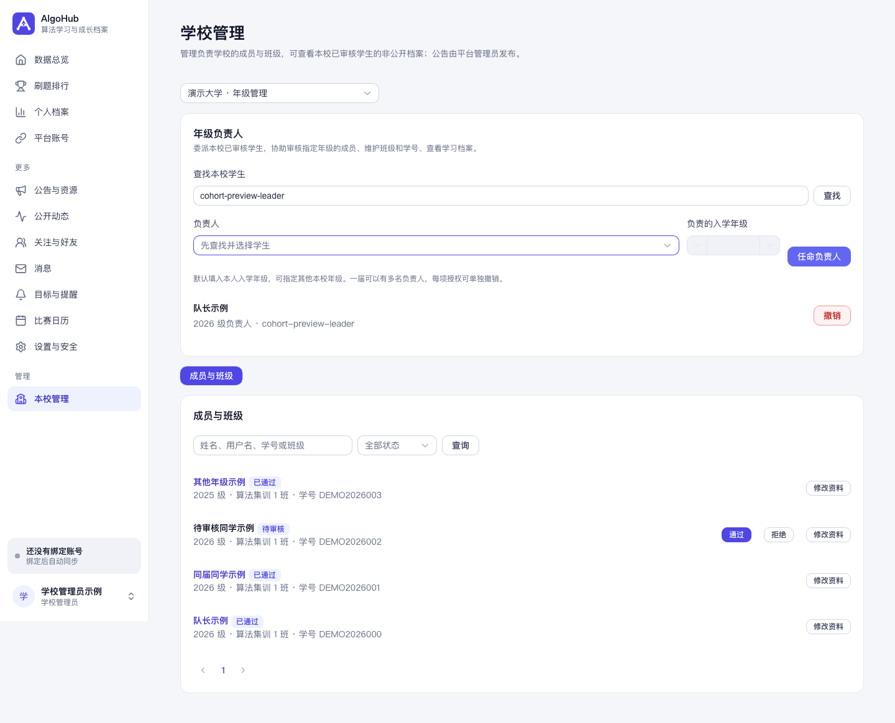
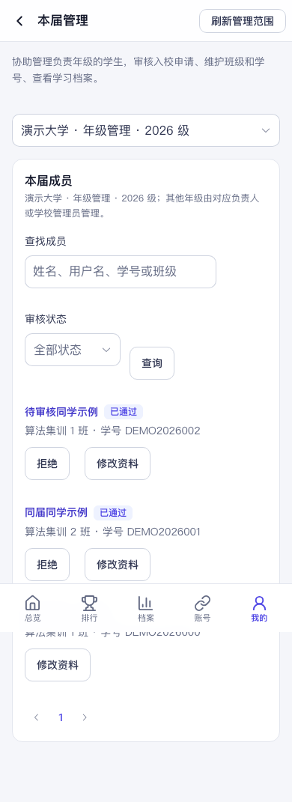

# 年级负责人（队长）

学校管理员可以把指定入学年级的日常成员管理工作委派给本校学生。一届可以有多名负责人，同一学生也可以分别负责多个年级。负责人仍然是普通学生账号。

## 学校管理员任免

1. 打开“学校管理”，选择自己负责的学校。
2. 在“年级负责人”区域按姓名或用户名查找本校学生。
3. 选择候选人。候选人须为正常状态、已通过本校审核的普通学生。
4. 确认负责的入学年级，点击“任命负责人”。默认填入候选人本人的年级，也可指定本校已有或当前开放的其他年级。
5. 撤销某项授权时，在对应年级负责人记录上点击“撤销”并确认。

学校管理员、平台管理员和未通过本校审核的用户不能作为候选人。具备学校管理权限的平台管理员也可使用上述任免入口。

## 负责人管理成员

任命后刷新页面，侧栏或手机“我的”页面中会出现“本届管理”。只有一个管理范围时直接进入；有多个范围时先选择学校和年级。

可以在授权范围内搜索成员、审核普通学生的入校申请、修改班级和学号，并查看已审核学生的学习档案。学号和班级的编辑不会更改入学年级。

不能任免负责人、审核本人、调整其他有效负责人的成员状态，或修改学校管理员和平台管理员。成员学校、入学年级的调整仍由学校管理员处理。

负责人不会额外获得邮箱、平台凭据、私人收藏笔记、社交或平台后台的访问权限。其他年级原本公开的档案仍按普通用户规则可见，但负责人身份不能读取这些学生的私密档案。

## 授权失效

- 主动撤销后，已有登录状态也不能继续管理该范围；打开中的页面在下一次请求时清空失效范围的名单和编辑窗口。
- 负责人离校、学校成员审核状态撤回、本人入学年级或所属学校变化后，旧授权撤销。
- 负责人账号被禁用，或被提升为学校管理员、平台管理员时，旧授权撤销。
- 恢复账号、恢复原年级或重新通过成员审核，不会自动恢复旧授权，需重新任命。
- 只修改班级、学号不影响负责人授权。

任免、成员审核、资料修改以及非公开学习档案的管理读取均会留审计。第一版不包含训练目标分配、提醒发送、公告或训练活动管理。

## 界面示例

以下学校、账号及成员资料均为虚构测试数据。

## 升级与回滚

本功能新增 Flyway V63 迁移，创建负责人授权表、索引和身份变化撤销触发器；不改写原有迁移。上线前确认目标主分支的迁移编号没有冲突。

没有用户会自动获得负责人身份。回滚到不支持本功能的应用版本前，应先撤销负责人授权；旧应用不提供新管理入口。不要删除 Flyway 历史记录，结构清理应使用后续迁移，并先确认审计数据保留要求。

## 验证记录（2026-11-01）

独立本机 PostgreSQL 16.15 测试库和 Redis 7.4.9 DB 15，Java 21.0.13、Maven 3.9.15、Node.js 22.19.0：

- `mvn -B verify`：719 项，0 失败、0 错误，2 项默认关闭的源站联网测试跳过。
- 新增负责人权限测试 10 项、真实 PostgreSQL 生命周期/并发测试 3 项通过。
- 前端类型检查、生产构建、浏览器同步及全部页面回归脚本通过；新增 `npm run test:cohort-management` 已接入 CI。
- 年级管理回归随现有 `test:list-recovery` 入口一起运行，现有 CI 会自动覆盖；也可用 `npm run test:cohort-management` 单独执行。
- 真实无界面 Chrome 使用虚构学校和账号完成任命、成员资料修改、入校审核及撤销后清理检查；390px 手机布局无横向溢出，未出现页面脚本错误。

上述结果来自本地测试环境，不代表已发布、已在真实学校试用或已完成生产部署。源站联网同步、真实邮件和 OAuth 不是本功能的验收范围。
