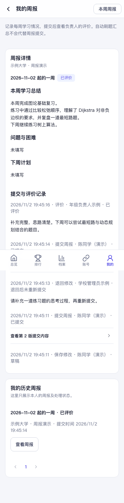
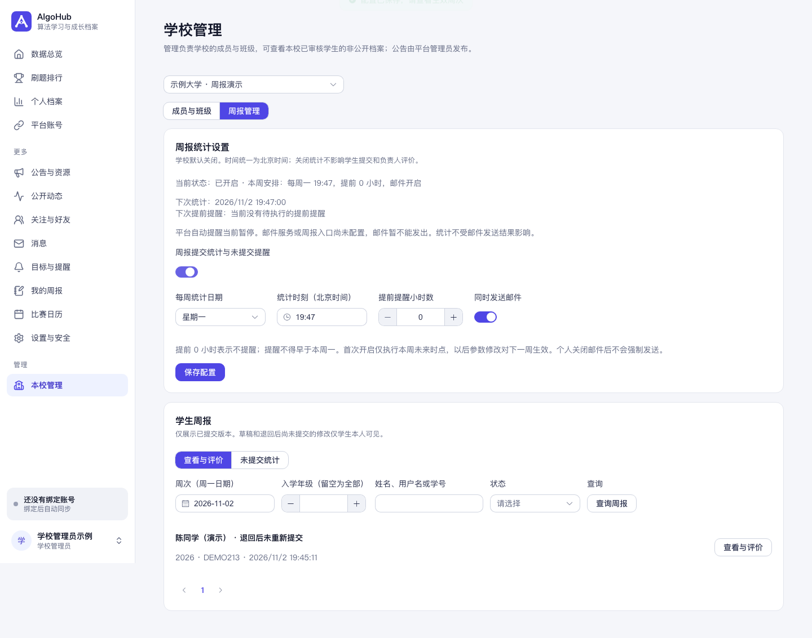
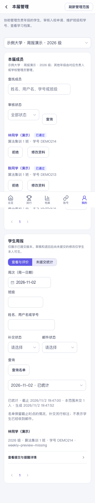

# 学生周报、提交统计与未提交提醒

学生从侧栏或手机“我的 → 我的周报”进入。学校管理员从“学校管理 → 周报管理”进入；年级负责人在“本届管理”查看授权年级的周报。现有自动“每周学习报告”仍是刷题汇总，不代表学生已提交周报。

功能讨论：[Issue #15](https://github.com/longtiandragon/algohub-community/issues/15)；代码审查：[PR #16](https://github.com/longtiandragon/algohub-community/pull/16)。

## 填写与评价

- 时间统一为北京时间自然周，周一至周日，以周一日期标识周次。
- 已审核、正常学生可创建本人本校周报。学习总结必填，问题与困难、下周计划选填；无刷题记录也可如实提交。不能创建未来或加入学校前的周次。
- 草稿正文只有本人能看。保存草稿不算提交，删除仅隐藏草稿并擦除正文；为准确重建截止状态，必要的状态和时间元数据保留至账号删除。
- 已提交周报不能直接修改或删除。负责人可评价，或填写原因后退回；学生修改后须重新提交。负责人只能读已提交版本，不能读尚未重新提交的修改。
- 评价、退回和重新提交保留版本及操作记录。多个负责人处理同一版本时，后到操作提示刷新，不覆盖先到结果。任何负责人不能评价本人周报。
- 学生可读本人历史周报和评价。失去原校学生身份后不能继续向原校提交，但本人历史仍可查看。

## 权限

| 操作 | 学校管理员／具备学校与成员权限的平台管理员 | 年级负责人 | 普通学生 |
|---|---|---|---|
| 查看、评价已提交周报 | 管理学校范围 | 明确授权学校＋入学年级 | 仅本人查看 |
| 查看草稿正文 | 不允许 | 不允许 | 仅本人 |
| 统计配置及提醒概况 | 管理学校范围 | 不允许 | 不允许 |
| 学校开启时的未提交名单 | 管理学校范围 | 授权年级，排除本人记录及本人提醒详情 | 不允许 |
| 学校关闭后的历史名单 | 管理学校范围，只读 | 不允许 | 不允许 |

负责人本人仍是应交学生。学校管理员及其他有权限负责人管理其周报和未交记录；年级负责人自己的名单记录不计入其管理汇总。只有内容、同步或其他平台权限不会自动获得学校周报权限。

授权在每次请求重新检查，撤销、停用、成员身份或角色变化沿用既有年级委派失效规则。历史已提交周报保留原学校及年级；历史名单保留截止时的归属，新学校不会得到原校内容。切换管理范围、失去权限或关闭学校统计后，页面清除失效数据。

## 学校配置与生效时间

新学校及已有学校的统计功能均默认关闭。表单默认周日22:00、提前6小时、邮件开启仅供填写，不代表已启用。

开启需有效统计星期和时刻，提前小时为0～167的整数，并且不能使提醒早于本周一00:00。0表示不提前提醒，不转为截止时点发送。学校邮件开关只影响邮件，个人站内提醒保留。

首次启用使用本周尚未到达的时点；已错过时点不追补。以后修改统计时刻、提前小时和邮件开关均从下周生效，界面分别展示本周和待生效配置、下一次统计及提醒时间。每校每周的执行周期会保存当周规则，不追改已生成快照。

关闭需要二次确认，立即停止新统计并取消尚未发出的邮件。邮件发送中的操作按顺序完成后关闭生效，已经发出的邮件不能撤回。历史名单保留，周报提交、查看和评价继续可用。重新开启不追补关闭期间错过的周次和邮件。

## 截止快照

应交范围为当时本校审核通过、账号正常的普通学生，包括年级负责人；学校管理员、平台管理员、待审／拒绝成员和停用账号不默认纳入。班级、学号缺失不免报；年级缺失仅学校管理员可见。刷题月目标为0、年级停止开放选择不代表免交周报。

截止时已提交、已评价算完成；未创建、草稿和退回后未重新提交算未交。统计即使未交人数为0也有“已统计”记录；待执行、失败和关闭不能显示成0人。

未交快照保存截止时的成员资料、状态、最后编辑时间及提醒结果。页面另外展示当前周报和邮件处理状态。补交保留原未交结论，附加首次补交及最近提交时间；补交后退回仍显示当前退回状态。支持周次、年级、班级、姓名／用户名／学号、补交及截止邮件状态筛选和分页。

成员资格与资料、周报状态和邮件结果分别保留时间历史，延迟统计及失败重试读取原截止状态。连续开启期间，停机跨周后可补建漏掉的周期；过期提醒不会补发。统计先等待在途报送和成员变更；锁定期间新加入成员使本次事务回滚并自动重试，避免快照缓存旧范围或产生逆序锁。

## 邮件和站内提醒

提前时点仅为当时未提交的应交学生生成本人提醒。内容包括现有显示名、周次日期范围、截止时间、尽快提交提示及个人周报入口，不含其他学生资料。

邮件只使用已验证登录邮箱，不使用公开联系邮箱。学校开启邮件不能覆盖个人退出接收设置；无邮箱和个人关闭分别记录，站内消息仍保留。名单不返回完整登录邮箱或邮件正文。

每学生、学校、周次只生成一条业务提醒；重复执行和开关不能重复生成。每封实际发送前重新检查截止时刻、学校开关、学生资格、提交情况和邮件接收设置。已经提交者取消未发邮件；过期邮件不积压补发。

发送失败有限重试，最多5次，依次间隔5、10、15、20分钟；截止后不再重试。结果区分待发、发出、失败、无邮箱、个人关闭、学校关闭、已提交取消、过期等情况。学校管理员可读人数概况，不读完整邮箱或内部异常文本。

“邮件已发出”只表示邮件服务接受，并不保证最终送达或阅读。发送接受后进程异常退出可能重复投递，业务去重不构成收件端绝对一次承诺。

自动提醒沿用 `algohub.reminders.enabled`；普通开发和测试默认关闭，生产沿用既有 `REMINDERS_ENABLED` 控制。统计由学校开关决定，邮件暂停或失败不阻塞统计。邮件服务和 `PUBLIC_ORIGIN` 缺失时明确显示不可发送，等待配置；过期后不补发。周报邮件复用既有通知和邮箱服务，由专门消费者处理，通用学习提醒消费者跳过这些记录。

## 升级与回滚

新增 Flyway V64，不改写已发布迁移。新增周报、版本事件、学校配置及规则、周执行周期、未交快照、提醒关联、成员历史和邮件结果历史，并为现有成员初始化历史。上线前确认目标分支的迁移编号没有冲突。

没有学校被自动开启，没有用户被自动任命。历史记录从迁移起可重建，不伪造迁移前的应交范围。学校已有周报或周期时禁止删除学校，防止误删教学历史。

回滚应用前先关闭所有学校周报统计并停止新功能任务。旧应用没有学生报送入口；通用邮件消费者必须继续排除周报队列，或确保没有待发周报邮件，再回退到不识别新表的旧版本。保留迁移和业务数据；不要删除Flyway历史。若需要清理结构，应另写后续迁移并先确认历史保留和成员历史触发器依赖。

## 本期范围

不增加自定义学校时区、真实姓名采集、附件、打分量表、导出、手动重算、手动补发、免报名单、补交自动移除或关闭时删除历史。年级负责人不会额外获得邮箱、平台凭据或其他后台权限。

## 页面示例

以下账号、学校和数据均为虚构。

## 验证

新增 `WeeklyReportTest` 验证报送、权限、草稿隐私、配置生效、精确截止、补交、历史成员、去重、邮件退出、失败、结果冻结、分页与跨周恢复。`WeeklyReportConcurrencyTest` 使用真实PostgreSQL事务验证提交／删除／成员更新与统计互斥、新人入校回滚重试、注销与邮件锁顺序。

前端 `npm run test:weekly-reports` 覆盖切换范围、权限失效、旧确认窗口、自评、草稿保存失败、详情延迟和分页之外的本周记录查找，随现有 `test:list-recovery` 进入CI。

2026-11-02，在专用本机PostgreSQL16.15及Redis7.4.9 DB15，Java21.0.13、Maven3.9.15、Node22.19.0下完成：

- 后端 `mvn -B verify`：752项，0失败、0错误，2项默认源站联网测试跳过；其中新业务测试26项、真实数据库并发测试5项。
- 测试基准时间显式对齐PostgreSQL微秒精度，避免不同系统时钟精度导致“恰好到点”用例提前不足一微秒；保留精确截止断言。
- 前端类型检查、全部现有回归与新增周报回归、生产构建通过；已有较大图表分包提示保留，未新增依赖。
- QOJ采集器6项Python回归通过。
- 真实无界面Chrome、虚构账号：草稿、提交、退回、重交、年级评价、实际学校配置表单、真实定时截止快照、学校及年级名单、关闭后清理均通过；390px稳定布局无横向溢出，无页面脚本错误。
- 待提交源码Gitleaks扫描通过，未发现秘密信息。

以上为本地验证，不代表已部署、真实学校试用或真实SMTP最终送达。浏览器预览的自动邮件和外部同步均关闭，邮件发送逻辑使用测试发件器验证。
