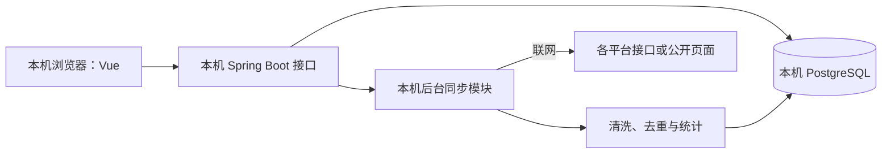

# 深圳职业技术大学算法学习平台：技术路线与实现目标

> 整理日期：2026-09-12
> 文档用途：作为需求设计、平台接入验证和后续开发的共同依据。
> 当前状态（2026-09-17 更新）：本地网页版已运行。Codeforces、AtCoder、杭电支持提交历史；洛谷、QOJ 的真实 AC 分页、首次 AC 去重、动态与导出已完成账号验收，详见 `docs/2026-09-15-真实同步验收.md`。洛谷、QOJ 当前仅同步 AC，不包含 WA；不能承诺登录态长期有效。
> 牛客已接入提交历史及 Tracker 统计，两者统计范围可能重叠，不直接相加；力扣、码蹄集仍有数据覆盖限制。各平台缺失时间的题目不伪造通过日期。
> 实测结论见 `docs/P0-平台能力实测报告.md`，实现进度与未完成项见 `docs/进度记录.md`，启动方式见 `README.md`。
> 2026-09-14 校正：上面的首版能力描述是历史记录；洛谷已支持通过题单、牛客已增加 Tracker 数据。最新状态以进度记录为准。当前优先完成身份认证、权限和既有功能闭环，暂不扩展训练题单、收藏、积分等功能。登录邮箱必须验证，不限定学校邮箱后缀，邮箱验证不授予学校身份；保留密码登录时同时提供邮箱验证码找回。
> 当前运行目标：只在本机浏览器运行，前端、后端和数据库均部署在本机；获取 OJ 最新数据时联网。
> 身份验收边界：邮箱验证码为默认登录方式，密码可选且已有找回入口；近期输入校验与未配置提示已浏览器检查，完整 SMTP 投递、换绑和找回的当前端到端复验仍待完成。GitHub OAuth 未配置，入口明确禁用，不记为已验收。后端自动化测试、构建和接口状态检查均不替代真实邮件或 GitHub 授权验收。

## 1. 项目定位与范围

开发一个面向深圳职业技术大学学生的算法学习网站，帮助新生加入校内组织、绑定多个刷题平台账号、查看学习记录和校内排名，并发现算法学习资源与即将开始的比赛。

首批规模为 **100～300 名注册用户**。峰值在线人数尚未确认，不把注册人数直接当作并发量。开发者熟悉 **Java / Spring Boot**，采用响应式网页，兼顾电脑和手机，后续视需求增加 PWA 安装能力。

上述人数是未来校内推广规模。**当前先开发本地网页版**，通过 localhost 使用，不部署公网服务、不打包桌面 App，也不要求新生安装客户端。学校成员和榜单流程在本地用测试用户验证，不能将本地演示称为全校实时在线服务。

用户确认 OJ Insight 是朋友的项目，可以借鉴。将其平台适配、统计语义、本地缓存与错误处理作为主要参考，结合本项目的 Java / Spring Boot 技术栈实现；不以整套移植桌面框架作为前置条件。

第一阶段只服务深圳职业技术大学。数据库保留学校实体和成员关系，仅初始化本校，不开发多学校申请、认证和运营流程。

项目重点是校内学习组织、多平台学习档案和可信统计。已有开源项目具备团队或校队功能，本项目不以“其他产品没有团队功能”为前提。

### 1.1 已确认与待确认

| 项目 | 状态 |
|---|---|
| 服务学校 | 已确认：深圳职业技术大学 |
| 首批用户规模 | 已确认：100～300 人 |
| 主要后端技术 | 已确认：Java / Spring Boot |
| 当前运行形态 | 已确认：本地网页；Vue、Spring Boot、数据库均在本机 |
| OJ Insight | 用户确认是朋友的项目，可以借鉴；具体借鉴计划见 8.3 |
| 统计内容 | 已确认：通过数、每日热力图、校内榜单、数据图表、难度与标签 |
| 比赛功能 | 已确认：比赛预告及类别筛选 |
| Cookie 接入 | 纳入技术方案，逐个平台验证可用性与数据范围 |
| “加入学校的 ID” | 暂按学校邀请码加入组织理解；如实际指学号，开发入校流程前确认 |
| 服务器 | 已有国内阿里云 2核2G、美国 2核4G；美国月流量 200GB；最终部署方案待定 |
| 项目名称、域名、备案状态、续费预算 | 待确认 |

## 2. 功能目标

| 模块 | 第一阶段目标 | 后续扩展 |
|---|---|---|
| 首页导航 | 展示 OI Wiki、博客园、精选算法博客、各 OJ 和工具，支持分类 | 收藏、校内推荐资源 |
| 注册与入校 | 注册登录、学校邀请码、成员审核、年级与班级信息 | 有学校授权后再考虑统一身份认证 |
| 平台绑定 | 填写平台 UID / 用户名，本地后端按需使用 Cookie，显示归属验证与同步状态 | 独立助手或浏览器扩展 |
| 个人档案 | 累计通过数、热力图、近期通过题目 | 难度分布、标签分布、长期趋势 |
| 校内排行 | 总榜、周榜、新生榜，支持平台与年级筛选 | 月榜、训练题单完成榜 |
| 比赛日历 | 未来比赛、北京时间、倒计时、原站链接、类别筛选 | 日历订阅、用户主动订阅提醒 |
| 管理后台 | 成员审批、导航维护、同步状态、失败重试 | 数据纠错、训练题单管理 |

本地前后端及数据库启动后，网站自身登录、查询缓存、计算本地榜单不依赖公网；登录原 OJ、同步最新记录、更新比赛和打开外部链接需要联网。没有网络时保留并展示上次成功同步的数据。关闭本地后端或电脑后，定时同步停止。

首版以链接导航和学习统计为主，不建设代码评测机。题目仅保存统计所需元数据与原站链接。

## 3. 测试账号清单

以下信息由用户提供，**仅登记为后续测试输入，尚未验证账号存在性、账号归属、公开范围或接口可用性**。不自动修改疑似拼写差异，不将昵称直接视为唯一 UID。

| 平台 | 用户提供的账号 / 标识 | 接入前核对项 | 当前状态 |
|---|---|---|---|
| Codeforces | `sample_user_hdu` | 验证 handle、公开提交与题目字段 | 待测试 |
| AtCoder | `sample_user_hdu` | 验证用户及第三方提交数据覆盖范围 | 待测试 |
| 力扣 | `boring-dubinskyt84` | 优先按中国站验证，核对账号 slug；国际站单独处理 | 待测试 |
| 洛谷 | `sample_user_hdu` | 从用户名确认数字 UID，核对隐私设置和可见记录 | 待测试 |
| 牛客 | `337279670` | 验证数字 UID，区分练习与竞赛数据范围 | 待测试 |
| 杭电 OJ | `longtina0828` | 按原文测试，注意与其他平台的 `sample_user_hdu` 拼写不同 | 待测试 |
| 码蹄集 | `龙天` | 可能是展示昵称，需要确定唯一用户 ID 或主页链接 | 待测试 |
| QOJ | `sample_user` | 验证用户及匿名、登录后可见范围 | 待测试 |

蓝桥云课尚未提供测试账号。需要本人登录态的平台，在对应验证阶段再由用户通过合适的本地配置方式提供，不把真实 Cookie、密码或 Token 写入本文档和 Git 仓库。

## 4. 平台接入策略

接入优先级：**官方公开 API → 合适的第三方 API → 登录态接口或公开页面 → 本地授权同步**。

每个平台分别记录以下能力，不能仅用一个“支持 / 不支持”字段表示全部功能：

- 用户资料及唯一身份标识。
- 累计通过数、已通过题目列表。
- 带时间的提交记录、可查询历史范围与分页方式。
- 题目难度、算法标签。
- 比赛列表和分类。
- 登录态需求、归属验证方式、更新时间与请求限制。

### 4.1 基于前期资料核查的接入判断

下表来源于公开文档、页面和开源代码核查，不是上述测试账号的实测结论。实际开发必须重新验证接口、权限和字段口径。

| 平台 | 当前判断 | 计划 |
|---|---|---|
| Codeforces | 有官方公开 API，提交、时间、结果、题目难度和标签较适合完整统计 | 第一批，打通完整流程 |
| AtCoder | AtCoder Problems 提供第三方提交与题目 API；难度是第三方估计，基础数据无完整算法标签 | 第一批，明确第三方来源与历史覆盖 |
| 洛谷 | 有公开题目、通过记录和个人趋势展示；网页采集与隐私限制需验证，不能将开放评测 API 当作个人统计 API | 第一批验证，按实际能力有限上线 |
| 牛客 / 牛客 Tracker | 有刷题追踪与团队功能；接口权限、题目范围和时间含义需确认 | 第二批优先；Tracker 不作为独立 OJ 重复累计 |
| 力扣 / LeetCode | 有网站内部 GraphQL 和登录态查询实现；两站能力可能不同 | 第二批，公开与本人登录模式分别验证 |
| 码蹄集 | 官方展示通过数、日历和用户详情入口；任意账号查询与历史分页待验证 | 第二批验证 |
| 杭电 OJ | 有历史用户统计和提交查询实现，当前可用性尚未验证 | 独立验证后决定支持范围 |
| QOJ | 前期资料核查中部分用户与提交入口需要登录 | 先验证登录后的权限与数据范围 |
| 蓝桥云课 | 个人刷题数据入口需要登录 | 验证本人登录态查询或导出 |

无法稳定自动统计的平台仍可收录导航、展示用户填写的账号链接，并明确标为“暂不支持同步”。

### 4.2 Cookie 接入

Cookie 用于复用用户授权的登录身份，但不能扩大账号原有权限，也不能生成源站没有提供的历史数据。

区分两种场景：

1. 登录后即可查看其他人的公开数据：可能只需要一个采集账号，须验证平台权限与使用规则。
2. 只有本人能查看自己的记录：需要每位用户分别授权，管理员 Cookie 不能代替学生本人的身份。

当前由本机 Spring Boot 托管登录态，流程如下；未来迁往云端时再单独决定是否托管学生凭据：

```text
用户选择平台并提供登录态
    → 请求本人信息接口，核对实际 UID
    → 绑定当前本地网站用户，在本机加密保存凭据
    → 本机后端低频、分页同步
    → 失效时暂停任务并提示重新授权
```

实现要求：

- 当前网页与后端仅监听本机回环地址，本地开发可用 HTTP；访问原 OJ 使用 HTTPS。未来开放局域网或公网时配置 HTTPS，不沿用仅面向本机的运行设置。凭据加密存储，解密密钥与数据库分离。
- 本地接口仍实施登录、来源限制和 CSRF 防护，不将 localhost 等同于任意网页可调用的开放代理。
- 日志、错误报告和管理界面不回显凭据；仅允许向对应平台的固定域名发送。
- 实际请求可能需要 Cookie 之外的 CSRF Token 或其他平台要求的字段，按接口验证结果实现。
- 用平台返回的本人 UID 校验绑定关系，不只相信用户手填账号名。
- 区分凭据失效、限流、验证码、源站异常和解析失败，不对所有错误无限重试。
- 支持删除托管凭据与解除绑定；删除本地副本不代表撤销原平台会话。
- 登录态权限可能包含账号写操作，本项目采集器只实现统计所需的读取功能。

### 4.3 本地同步

当前“本地同步”由本机 Spring Boot 完成：浏览器发起任务，后端访问 OJ，将结果写入本机数据库。无需另写桌面助手，也不把凭据或记录上传到校外云服务器。

对于需要浏览器环境的平台，后续按实测结果增加浏览器扩展或本地工具。未来如建设云端学校服务，可由可选助手在用户本机读取学习记录，仅上传必要数据。

普通网页不能直接读取另一个站点的 Cookie。当前由用户主动提供所需登录态，本机后端携带它请求；本地后端持续运行时，关闭网页不影响已配置的后台任务，但退出后端或休眠会暂停同步。

## 5. 统计口径

### 5.1 核心指标

| 指标 | 定义 |
|---|---|
| 累计通过题数 | 同一用户、同一平台、同一题多次通过只计一题 |
| 每日新增通过题数 | 首次通过该题的时间落在当天，前提是历史覆盖足以确认首次通过 |
| 每日去重通过题数 | 当天通过的题目去重，允许包含以前通过过的题 |
| 每日提交次数 | 当天所有提交，包括重复提交和未通过 |
| 观察增量 | 两次同步之间观察到的总数变化或新增题目，不能冒充准确首次 AC 日期 |

例：昨天通过 A，今天再次通过 A 两次、首次通过 B 一次，则今天新增通过为 1、当日去重通过为 2、提交次数为 3。

### 5.2 一致性规则

- 热力图提供清晰的指标名称；仅在数据允许时展示首次 AC 指标。
- 初次绑定导入的历史题回填原日期；未知日期不能全部计入绑定当天。
- 只有总数的平台保存快照和观察增量，不伪造逐日历史。
- 原始时间统一保存 UTC，校内每日统计按 `Asia/Shanghai` 划分。
- 提交以平台与提交 ID 幂等入库，重复抓取不重复计数。
- 题目首先按平台与题目 ID 去重；同一来源的复用题、跨平台搬运题通过明确映射处理，不靠题名猜测。
- 未完成跨平台映射时，总量标为“各平台通过数合计”，不声称全球唯一题量。
- 牛客 Tracker 数据与牛客同源时不能重复累计。
- 重判可能改变结果，需回查近期提交，并保留纠错与重算能力。
- 同步失败保留旧数据，显示更新时间，不将失败结果写成零。
- 未评级、标签缺失与历史不完整均保留明确状态，不以零或“简单”代替未知。

### 5.3 排行榜

优先支持累计榜、周榜、新生榜，再增加月榜、年级榜和题单榜。精确时间榜仅纳入同一口径且时间可核验的数据，展示参与统计的平台范围与更新时间。

总数快照、未核验账号可用于个人展示或单独标识的榜单，不与已验证记录无区别混排。新生榜按入学年级划分，不按注册日期替代。

账号唯一归属按平台稳定 UID 约束；平台仅提供 handle 时保留标识变更记录。公开榜默认使用昵称，学号等身份信息如确需收集，仅用于成员管理。

## 6. 难度、标签与图表

保留平台原始难度，不直接把各平台分数换算成一个统一能力值：

- Codeforces：原始题目 rating，允许缺失。
- 洛谷：原始等级、名称和颜色，以配置维护。官方 2026 年调整过难度体系，包含新增青题，不能照搬旧分档。
- AtCoder：AtCoder Problems 估计难度，界面明确标注第三方来源。
- 力扣：Easy / Medium / Hard。

标签保存原始值与来源，另建动态规划、图论、字符串、数据结构、数学等统一分类及映射。多标签题可贡献多个分类计数，图表说明口径；标签覆盖不完整时显示覆盖范围。

图表目标：热力图、累计通过趋势、各平台通过数、难度分布、标签练习分布。标签分布表示练习接触情况，不直接称为掌握程度或能力评分。

## 7. 比赛日历

保存平台比赛 ID、标题、起止时间、时长、状态、类别、原站 URL、来源与最后更新时间。时间保存 UTC，默认展示北京时间。

| 平台 | 分类目标 |
|---|---|
| AtCoder | ABC、ARC、AGC、AHC，其他类型单独保留 |
| Codeforces | Div.1 / 2 / 3 / 4、Educational、联合场次 |
| 力扣 | 周赛、双周赛 |
| 牛客等 | 根据官方类型与名称规则分类，支持人工修正 |

Codeforces 的 `Contest.type` 表示计分制，不是 Div。Div 等分类通过名称规则及人工覆盖维护，联合场次允许多个标签。

优先官方比赛数据，长尾平台可采用 CLIST 辅助聚合。按平台比赛 ID 或明确原站链接去重，并处理延期、取消与时间变更。第一版展示和筛选即可，提醒功能后续由用户主动订阅。

## 8. 技术栈与架构

| 层次 | 建议选型 | 说明 |
|---|---|---|
| 前端 | Vue 3、TypeScript、Vite | 响应式网页 |
| 组件与状态 | Element Plus、Vue Router、Pinia | 表单、排行、筛选、登录状态 |
| 图表 | Apache ECharts | 日历热力图和统计图 |
| 后端 | Java 21、Spring Boot | 开工时确认依赖兼容并锁定受支持版本 |
| 身份权限 | Spring Security | 登录及学生、管理员权限 |
| 数据库 | PostgreSQL | 原始记录、统计和同步任务；如团队更熟悉 MySQL 可统一替换 |
| 数据访问 | MyBatis、Flyway | SQL 查询与结构迁移 |
| 采集 | Java HTTP 客户端、jsoup | JSON 接口和 HTML 解析 |
| 调度 | Spring Scheduler、受限线程池、数据库任务表 | 增量同步、重试与执行状态 |
| 当前运行 | Vite 开发服务器、本机 Spring Boot、本机 PostgreSQL | 前端通过 `/api` 代理访问后端；数据库可原生运行或单独使用 Docker |
| 后续部署 | Nginx、Docker Compose | 留待公网部署时使用 |

当前启动 Vite、一个 Spring Boot 应用和一个 PostgreSQL 数据库即可，Nginx 不是本地开发前置依赖。建议前端 `http://localhost:5173`、后端 `http://127.0.0.1:8080`，端口冲突时可配置修改，服务监听回环地址。Vite 将 `/api` 请求代理给本机后端，浏览器不直接采集第三方 OJ。

同步逻辑在同一代码库内按模块划分，使用独立受限线程池。保留 PostgreSQL 是为了直接验证学校、多用户与统计关系，后续云端部署无需同时更换数据库；不因为 OJ Insight 使用 SQLite 就引入第二套数据库。



页面请求只读取已存储数据，不等待实时抓取。手动刷新提交到任务队列，前端展示排队、同步中、完成或失败。

### 8.1 模块划分

`auth`、`school`、`account`、`platform`、`sync`、`statistics`、`contest`、`resource`、`admin`。

平台适配器分别实现资料、提交、题目、比赛获取等能力，并返回分页游标、来源、覆盖范围和明确错误。平台差异保留在适配层，不散落在排行榜业务中。

### 8.2 核心数据实体

| 实体 | 关键内容 |
|---|---|
| 用户、学校、成员关系 | 身份、入校状态、年级、班级、角色 |
| 平台账号 | 平台 UID、handle、归属验证、授权方式、同步状态 |
| 平台凭据 | 加密登录态、凭据版本、最近验证时间；与普通资料分开管理 |
| 题目、难度、标签 | 原始平台题号、来源关系、难度、标签映射 |
| 提交记录 | 原始提交 ID、账号、题目、结果、提交时间、采集时间 |
| 用户通过题目 | 去重后的通过关系、最早已知 AC 时间、首次时间可信状态 |
| 日统计、总数快照 | 指标类型、日期、覆盖平台、统计来源 |
| 比赛 | 时间、分类、状态、链接和来源 |
| 同步任务、游标 | 执行状态、历史回填进度、重试、错误、更新时间 |
| 导航资源 | 分类、标题、链接、介绍、排序 |

首次通过时间与“当前已知的最早通过时间”分开表达。保留原始记录，以便修正规则后重算统计。

### 8.3 OJ Insight 与 oj_helper 借鉴路线

OJ Insight 是用户朋友的项目，用户已明确可以借鉴，本阶段按此推进设计与实现。记录实际采用的来源和修改；当前工作不涉及对外分发朋友的完整项目。

| 参考对象 | 已查看的内容 | 本项目实现方式 |
|---|---|---|
| OJ Insight `src-tauri/src/sync/` | 六个平台分文件适配、Cookie 请求、增量与错误处理 | 在 Java 中按平台建立适配器，实测后迁移有效的请求与解析逻辑 |
| OJ Insight `models.rs` | 逐题记录、日期汇总、难度、游标和同步状态分离 | 用 Java DTO 与 PostgreSQL 表表达相同边界，增加学校、成员及归属验证 |
| OJ Insight 热力图与难度分析 | First AC、Unique AC、AC Submissions、Platform Activity 分开；各平台难度独立展示 | 用 Vue + ECharts 实现，保留数据来源、可用范围和未知状态 |
| OJ Insight 本地缓存 | 增量、重建、同步错误与历史缓存分离 | 本机数据库保存记录；源站失败仍可查旧数据，重建失败不先删旧记录 |
| oj_helper 比赛查询 | CF、AtCoder、洛谷、牛客、力扣、蓝桥等查询入口与解析 | 作为 Java 比赛适配器的验证线索，不能将旧接口视为必然可用 |

当前保持 **Vue 3 + Spring Boot + PostgreSQL**。OJ Insight 使用 React/Tauri/Rust/SQLite，oj_helper 使用 Flutter/Dart，它们的界面或服务文件不能直接放入本项目运行。借鉴其数据模型、接口调用和交互，再按本项目技术栈实现，不同时维护三套界面，也不引入 Rust 或 Dart 常驻服务。

需要特别保留的语义差异：OJ Insight 的 `AC Submissions` 只统计通过提交，不等于本项目规划的“全部提交次数”；它的 `Platform Activity` 也不能当作首次 AC 数。仅有日期、没有准确时刻的来源记录保存来源日期，不补造时间戳。

已看到 OJ Insight 的 QOJ Cookie 分页与登录失效处理代码，可以优先用于 QOJ 接入验证；尚未用用户的 QOJ 账号验证成功。oj_helper 的部分题量查询依赖第三方在线接口，不能视为完全独立的本地采集。

OJ Insight 现有账号 JSON 导出不代表训练记录导出。当前从各 OJ 获取数据；如以后增加 OJ Insight 数据导入，单独设计不包含 Cookie 的记录格式，不上传其整份数据库。

### 8.4 后续可选架构

完成本地网页版后，可将同一 Spring Boot 与 PostgreSQL 部署到服务器，增加校内多人访问。若之后确实需要本地凭据、离线缓存或浏览器环境，再增加可选助手或扩展；这些不属于当前实现前置条件。

未来助手上传记录时需包含账号归属、平台提交 ID、来源、时间精度及覆盖范围，服务端去重并重算统计。客户端上传仍可能被修改，不能因有签名或重算就视为源站已核验数据。

## 9. 同步与运行策略

建议起始频率如下，属于待实测调整的配置，不是实时性承诺：

| 数据 | 建议频率 |
|---|---|
| 活跃账号 | 30～60 分钟 |
| 不活跃账号 | 6～24 小时 |
| 比赛列表 | 30～60 分钟 |
| 题目元数据 | 按需获取、长期缓存、周期更新 |

同步机制：

- 首次历史分批回填，后续增量更新，近期记录进行适当回查。
- 按平台共享限速器，所有账号和任务共同遵守源站限制。
- 前期资料中 CF API 要求至少两秒调用间隔；AtCoder Problems 要求请求间隔超过一秒，上线时复核。
- 同一账号避免任务重叠，数据库记录任务状态、游标、重试时间和执行租约，重启后可恢复。
- 成功入库后再推进游标；对同秒多提交和分页边界做去重、完整性检查。
- 处理超时、429、5xx、登录失效、响应结构改变，有限重试并退避。
- 管理后台显示最近成功时间、错误分类、同步耗时、历史覆盖与待处理任务。
- 提供数据库定期备份、恢复验证、日志轮转；监测内存、磁盘、流量和同步失败率。

## 10. 后续服务器路线（当前不部署）

### 10.1 现有资源

| 资源 | 已知条件 | 适用判断 |
|---|---|---|
| 阿里云国内服务器 | 2核2G，临近到期；续费价格、带宽、磁盘和备案状态未提供 | 可以验证精简版本，正式使用前检查余量 |
| 美国服务器 | 2核4G，200GB/月；供应商、线路、单向或双向计费未知 | 适合开发与小范围试用，校园访问及登录态跨地域使用需实测 |

当前决定：开发与验证均在本机进行，不使用现有云服务器作为运行依赖。以下服务器比较仅供未来上线参考，不要求当前购买、续费、备案或部署。未来如国内续费合适且备案条件具备，可用国内 2核2G 小规模验证；长期推广优先评估国内 2核4G，最终以价格、备案和线路测试为依据。

200GB 月流量不直接判定为不足。例如 100 日活、每人每天加载 10MB，30 天约 30GB；200 日活、每人每天 20MB，则约 120GB。两者均为假设，不包含采集、备份等额外流量。需要确认服务商计费方向及超额规则。

国内 2GB 部署控制 JVM 内存、数据库连接池和同步并发，并在本机或 CI 构建。Cookie 存储开销很小，避免为每名学生常驻浏览器进程。能用 HTTP 接口完成的采集优先直接请求。

国内公网网站将备案纳入上线计划。美国与国内双节点采集留到实际存在网络问题时再考虑，初期不跨地域拆分数据库与业务请求。

### 10.2 上线前测量

- 校园网和移动网络访问页面、接口的成功率与延迟。
- 两台服务器访问目标 OJ 的成功率、限流与登录态可用情况。
- 常规浏览与历史同步同时运行时的内存、CPU、数据库连接、磁盘增长。
- 模拟预期并发进行性能测试，记录结果后确定刷新频率与容量。
- 测量一段时间的实际传输量，再估算整月费用与余量。

## 11. 分阶段实现目标与验收

| 阶段 | 实现目标 | 验收依据 |
|---|---|---|
| P0：本地数据验证 | 借鉴 OJ Insight 适配逻辑，用测试账号验证字段、分页与 Cookie；明确可复用行为 | 形成每平台能力报告；将实测结果与网页人工抽样对照，未验证项明确留空 |
| P1：本地最小闭环 | 启动本机前后端与数据库，实现注册、入校、绑定 CF / AtCoder、热力图、周榜、导航 | 浏览器可完成全流程；重复同步不重复计数；重启后记录仍在；断网可读已有数据 |
| P2：本地校内流程 | 比赛筛选、年级榜、新生榜、管理员功能、同步状态、洛谷可用能力 | 使用本地测试用户验证成员与榜单流程；平台故障不阻塞页面；不要求公网访问 |
| P3：平台扩展 | 牛客、力扣、码蹄集，以及验证可用的 HDU；难度和标签图表 | 按实际能力上线；缺失字段、部分历史和来源可见 |
| P4：授权扩展 | 蓝桥、QOJ 的登录态适配、本地同步 | 本人身份匹配、凭据失效处理、覆盖范围记录正确 |
| P5：本地交付 | 本地启动说明、配置模板、备份恢复、错误诊断 | 本机从配置到启动可复现，完成恢复验证，不依赖云服务器或桌面安装包 |
| 后续：公开服务与助手 | 视需要部署校内在线服务，增加可选本地助手、扩展和记录上传 | 单独确认范围后执行，不计入当前本地网页版验收 |

平台顺序可根据 P0 结果和新生实际使用习惯调整。Cookie 可用且数据完整的平台可以提前，不因前期匿名访问失败而直接放弃。

关键验证场景包括：重复 AC、跨日提交、同秒分页边界、首次历史导入、历史缺失、重判、改名、绑定冲突、登录失效、限流、任务中断恢复、题目无评级与重复来源映射。

第一版完成标准：**在本机浏览器中完成入校、绑定、同步、查看可信学习记录和比赛的流程；使用本地测试成员验证周榜；重启后数据保留，源站故障或断网时可查看缓存。** 这不等同于已提供全校在线服务。

## 12. 参考资料与复用边界

以下链接来自前期调研，接口与平台规则可能变化，接入时重新核验。开源代码可借鉴，不将 README 的平台列表视为生产可用保证。

- [OJ Insight](https://github.com/Whalica/OJ_Insight)：用户朋友的项目，已确认可借鉴；[采集模块](https://github.com/Whalica/OJ_Insight/tree/main/src-tauri/src/sync)、[数据模型](https://github.com/Whalica/OJ_Insight/blob/main/src-tauri/src/models.rs)、[QOJ 适配](https://github.com/Whalica/OJ_Insight/blob/main/src-tauri/src/sync/qoj.rs)。
- [oj_helper](https://github.com/2754LM/oj_helper)：[比赛采集](https://github.com/2754LM/oj_helper/blob/main/lib/services/recent_contest_services.dart)、[题量采集](https://github.com/2754LM/oj_helper/blob/main/lib/services/solved_num_services.dart)。直接复用其代码时保留并遵守仓库许可证要求。

- [Codeforces API](https://codeforces.com/apiHelp/)；[方法](https://codeforces.com/apiHelp/methods)；[对象字段](https://codeforces.com/apiHelp/objects)。
- [AtCoder Problems API](https://github.com/kenkoooo/AtCoderProblems/blob/main/doc/api.md)：第三方提交和估计难度。
- [洛谷官方更新日志](https://help.luogu.com.cn/release-note)：个人趋势、隐私与难度体系变化。
- [牛客 Tracker](https://www.nowcoder.com/problem/tracker)；[相关开源实现](https://github.com/qsmcgogo/nowcoder_tracker)。
- [LeetCode-Query](https://github.com/JacobLinCool/LeetCode-Query)：公开与登录态查询示例。
- [WUST Algo Tracker](https://github.com/WUSTACM/WUST-Algo-tracker)：团队邀请码、榜单、同步和统计设计；其部署组件较多，适合借鉴模块而非直接照搬架构。
- [OJHunt Lite](https://github.com/Liu233w/ojhunt-lite)：多平台适配器；主要返回总数或题目列表，不直接具备完整历史热力图能力。
- [CLIST API](https://clist.by/api/v4/doc/)：比赛聚合参考。
- [Spring 调度](https://docs.spring.io/spring-framework/reference/integration/scheduling.html)、[jsoup](https://jsoup.org/)、[ECharts 热力图](https://echarts.apache.org/examples/en/editor.html?c=calendar-heatmap)。
- [Cookie 机制](https://developer.mozilla.org/en-US/docs/Web/HTTP/Guides/Cookies)。
- [阿里云备案服务器要求](https://help.aliyun.com/zh/icp-filing/basic-icp-service/user-guide/icp-filing-server-access-information-check)。

## 13. 下一步工作

从 P0 开始：参考 OJ Insight 的采集与统计结构，在本机验证 Codeforces、AtCoder 和洛谷测试账号，建立统一的数据能力报告，再验证其余已提供账号。QOJ 等按需使用本人 Cookie。报告记录请求方式、是否需要登录、字段含义、分页覆盖、更新时间和实测限制。

在第一批数据链路成立后，确定 Java 数据模型、数据库结构与接口契约，开始本地 P1 开发。当前不创建云端部署或桌面打包任务。本文档更新不代表已经实现网页、启动服务或完成账号验证。
